# DSH Mobile Connector

Your DeepSeek Harness sessions, on your phone, over your own network.

Two pieces that work together: a host plugin that turns the running harness into a small authenticated HTTP API, and a native Android client that reads and continues your chats from anywhere the phone can reach the PC — home Wi-Fi, or a Tailscale tailnet from anywhere at all.

| Piece | Runs on | What it does |
|---|---|---|
| **`dsh-plugin-mobile-sync`** | inside DeepSeek Harness, as a Cordis host plugin (plain Node ESM, no dependencies) | Opens a dedicated HTTP listener with a per-device bearer-token model, and translates sessions, chat, photos, files, tool approvals, agent questions and permission presets into a small REST + SSE vocabulary. |
| **`android/`** | Android 8.0+ (API 26), Kotlin + Jetpack Compose | Session list grouped by project, full transcript with tool cards and diffs, rendered markdown, sending text / photos / files, approvals, agent questions, model and permission pickers, delivered artefacts, link previews. |

| Pairing | Chats | Transcript | Tool calls |
|---|---|---|---|
| 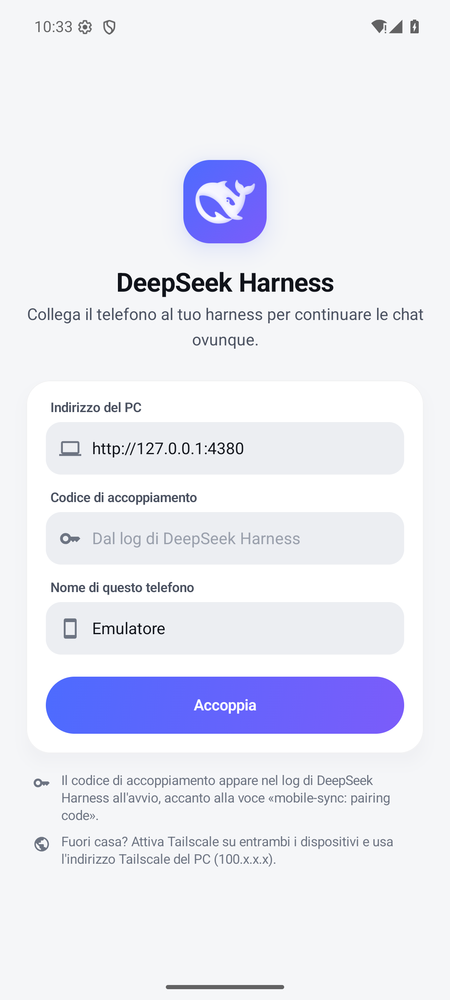 | 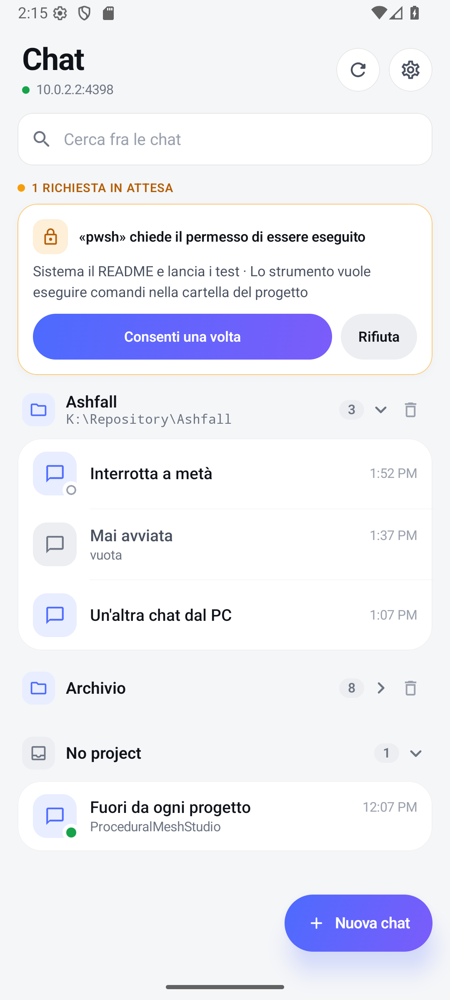 | 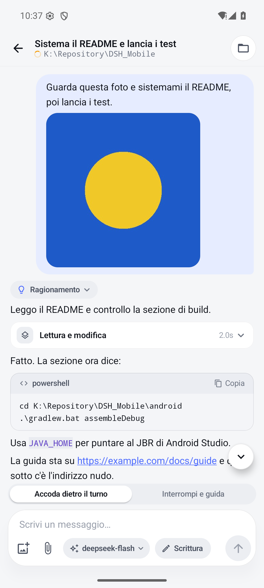 | 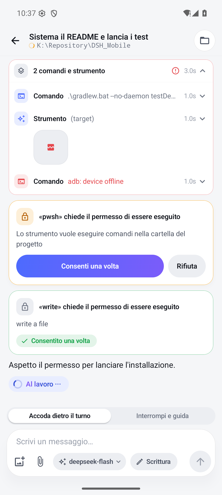 |

---

## Table of contents

- [Why a second listener](#why-a-second-listener)
- [How it works](#how-it-works)
- [Install the plugin](#install-the-plugin)
- [Pair the phone](#pair-the-phone)
- [Install the Android app](#install-the-android-app)
- [Build from source](#build-from-source)
- [Tests](#tests)
- [Repository layout](#repository-layout)
- [Security](#security)
- [Troubleshooting](#troubleshooting)
- [License](#license)

---

## Why a second listener

The shipped Web GUI binds loopback and authenticates browsers with a launch token plus a host-bound signed cookie. That contract is deliberately not reusable by a native phone client, so the plugin does not try to reuse it: it owns its own listener on its own port, its own bearer-token device model, and its own small REST + SSE vocabulary. The GUI's `/api` bridge and its SPA routes are never touched. A phone's traffic does not pass through the GUI, and a GUI change cannot break the phone.

```
┌──────────────────────────── PC ─────────────────────────────┐
│  DeepSeek Harness (Electron)                                │
│    ├─ Web GUI        127.0.0.1:19387   loopback, cookie     │
│    └─ mobile-sync    0.0.0.0:4380      LAN / tailnet, token │
│         sessionController · attachments · agents · web      │
└─────────────────────────────────────────────────────────────┘
                 ▲ home Wi-Fi  or  Tailscale
                 │ HTTP + Bearer token
          ┌──────┴──────┐
          │   Android   │
          └─────────────┘
```

The plugin is a *host* plugin: it runs in the harness process, on the harness's own Node runtime, and reaches the same services the desktop UI reaches. It imports nothing from `@deepseek-ai/*` — every service is injected through the Cordis context — so it has no version peer to keep in step with the app that hosts it.

---

## How it works

### The listener, the code and the devices

On activation the plugin opens one TCP listener on the configured `host`/`port` and prints the addresses a phone can actually dial — the LAN address and, when present, the Tailscale one — rather than the bind address:

```
mobile-sync: listening on http://0.0.0.0:4380
mobile-sync: reachable at http://192.168.1.146:4380  (same Wi-Fi only)
mobile-sync: reachable at http://100.101.102.103:4380  (Tailscale — works from any network)
mobile-sync: pairing code 3f9a1c7e5b2d4a80 — enter it in the app to pair a device
```

State lives in one file, `$DSH_HOME/storages/mobile-sync.json` (`%USERPROFILE%\.dsh\storages\mobile-sync.json` on Windows), written with mode `0600`, atomically (a flushed sibling file renamed over the old one, so a crash mid-write leaves the previous table intact). It holds the current pairing code and the device table — for each device a stable id, its name, its bearer token and when it was first and last seen. There is no user database and no account: a device *is* a token.

The listener defaults to `127.0.0.1:4380`, which admits no phone. Admitting one is the deliberate `host: "0.0.0.0"` in the plugin row, and a nonsensical `port` is refused at boot instead of bound somewhere surprising.

### Pairing, in full

Pairing is the one thing the listener accepts without a token (`POST /mobile/pair`), so its rules are worth knowing exactly:

- **The code never expires.** A short window would only punish a slow restart; a code that lives until it is spent is one you can read out of the log at your leisure.
- **It is single use.** The moment one device pairs, the code is retired and cannot be used by anything else on the network.
- **A spent code pairs nobody — not even a name already in the table.** The device label is a label; the old "re-pair by name" shortcut made it a password, and it is gone.
- **A new code can be minted without a restart**: open `http://127.0.0.1:4380/mobile/pairing-code` on the PC (or `curl -X POST` it). The route answers loopback only, because a code minted in reply to a network request is a code the network has already seen. A reinstalled app comes back this way.
- **A phone that still holds its token can rotate it** — `POST /mobile/pair` with its bearer header returns a fresh token for the same device id, no code involved. That is the answer to "I think this token leaked".
- **Revoking is `DELETE /mobile/devices/{id}`** — from the app's settings, or with `curl` on the PC; emptying `devices` in the state file still works and still requires a restart. Worth doing before lending the phone, not after.
- **Pairing attempts are rate limited** per address (ten a minute), and a refused attempt is logged.

Every other route requires `Authorization: Bearer <token>`. Tokens are compared in constant time, a token that no longer appears in the device table is `401 unauthorized`, and pairing failure is `403` with `pairing-refused`, `pairing-closed` or `rate-limited`.

### What the routes bridge

The route surface is small and deliberate. Full reference, field by field: **[docs/API.md](docs/API.md)**.

| Method | Route | Purpose |
|---|---|---|
| `POST` | `/mobile/pair` | Claim the pairing code, or rotate the token the caller holds. |
| `GET` / `POST` | `/mobile/pairing-code` | Mint a fresh pairing code, from the PC only. |
| `GET` | `/mobile/health` | Wire version, plugin version, counters — the cheap liveness probe. |
| `GET` / `DELETE` | `/mobile/devices[/{id}]` | The paired devices / revoke one (or the caller itself). |
| `GET` | `/mobile/status` | Listener, reachable URLs, paired devices, session counts. |
| `GET` / `POST` | `/mobile/sessions` | List sessions (grouped by project when the host has a workspace registry) / create one in a chosen folder. |
| `GET` / `POST` / `DELETE` | `/mobile/workspaces` | Read, adopt and remove the PC's project list. |
| `GET` / `POST` | `/mobile/dirs` | List one level of the real filesystem / create a directory. |
| `GET` / `POST` | `/mobile/sessions/{id}/messages` | Page the transcript / send a prompt. |
| `POST` | `/mobile/images`, `/mobile/files` | Upload a photo or an arbitrary file before sending. |
| `GET` | `/mobile/sessions/{id}/images/{attachmentId}/raw` | Serve an attachment image. |
| `GET` / `POST` | `/mobile/models` | The configured model catalog / select one (this is the *same* selection the desktop records). |
| `GET` / `POST` | `/mobile/approvals[/{id}]` | Pending tool approvals / answer one. |
| `GET` / `POST` | `/mobile/questions[/{id}]` | Pending `ask_user_question` sets / answer one. |
| `GET` / `POST` | `/mobile/permissions` | Permission presets / apply one to a session. |
| `GET` | `/mobile/file`, `/mobile/delivery` | Read a file a message linked / fetch an artefact the agent declared with `present`. |
| `GET` | `/mobile/preview` | Title, description and readable text of a link. |
| `GET` | `/mobile/events` | Server-Sent Events stream. |

### Live updates: polling, and an event stream for clients that want to be pushed to

`GET /mobile/events` is a Server-Sent Events stream: a `ready` frame on connect, a `retry: 3000` hint, a comment heartbeat every 15 s, and a `session-event` frame for every durable event the harness appends to a session. It is part of the API and it works.

**The Android client does not use it.** It refreshes the session list every 4 seconds and the open chat every 2.5 seconds, and that is a deliberate choice rather than an unfinished one: a poll survives phone suspend, a change of network and a Tailscale tunnel reconnecting, with no reconnection state machine to get wrong, and its cost is one small request per interval. The stream is there for a client that would rather be pushed to.

### The parts that are not obvious

- **Attachments are receipts, not bytes.** An uploaded file is stored by the harness's attachment backend and the prompt carries a handle to it; the agent reads the file with its own tools if and when it needs to. A phone therefore cannot smuggle content into the conversation that the agent did not choose to open.
- **One writer per session.** If the desktop is holding the session, `POST /mobile/sessions/{id}/messages` answers `409 session/writer-held` instead of fighting for it.
- **Approvals have no "always".** The vocabulary is the harness's own and does not widen: `allowed-once` is the only thing that grants anything, everything else — including a typo — denies. A pending approval lives in memory only, so a stale card on the phone can never answer a turn that no longer exists.
- **Link previews are fetched by the PC, with the harness's own fetcher.** That is the point, not a shortcut: the phone is not a second, softer entrance to the network the PC sits on. A request that resolves to a private or loopback address is refused (`preview/blocked`), and the phone still has "open in browser" as an explicit second tap.
- **Limits are the phone's, and they are finite**: 48 MiB request bodies, 12 MiB per photo, 32 MiB per file, 8 files per message, 400 messages of history per page request, 500 directory entries per level.

---

## Install the plugin

### Requirements

- A DeepSeek Harness build whose host mounts `sessionController`. The richer routes degrade rather than break: a service the host does not mount (`workspaceController`, `web`, `permissionPresets`, `userQuestions`, `fileUploads`) makes its route answer `404` or `503`, and the app says so in words instead of failing silently.
- No npm install, no build step. The plugin is one ESM file with `node:` builtins only.

### Add it to a profile

```powershell
# from the repository root
dsh plugin --profile desktop add "<repo>\dsh-plugin-mobile-sync"
```

Then make sure the profile mounts it. In `%USERPROFILE%\.dsh\profiles\desktop\cordis.patch.yml`:

```yaml
- insert:
    - id: mobile-sync
      name: "dsh-plugin-mobile-sync"
      config:
        host: "0.0.0.0"   # the default is 127.0.0.1, which admits no phone
        port: 4380
        # debug: true            # richer error codes in failure replies
        # approvalWaitMs: 120000 # how long an approval waits for the phone
        # questionWaitMs: 120000 # how long a question waits for the phone
        # protectedPaths: []     # more paths /mobile/file must refuse (the harness home is always refused)
```

> **The `insert:` wrapper is not decoration.** A row written as `- id: mobile-sync` is read as a *patch* against a row that does not exist: the boot logs `patch: entry "mobile-sync" not found` and the plugin never mounts. `dsh --profile desktop --dump-config` shows what the profile actually composed.

Profiles are read once, at boot: after editing the file, close and reopen the harness.

Because the package declares no `dsh.bundle.patch`, it installs as a *plain dependency* rather than a profile layer — so it does not appear in **Settings → Plugins**, and the row above is what mounts it. That is a classification, not a fault.

### Reach it from the phone

The phone must be able to open a TCP connection to `host:port`. On Windows the first bind on all interfaces may raise a firewall prompt; if it was dismissed, no device will ever connect. From the PC, `http://<lan-ip>:4380/mobile/status` answering `401` proves the listener is up (401 is correct: the token is missing).

```powershell
# as Administrator — private networks only
New-NetFirewallRule -DisplayName "DSH mobile-sync" -Direction Inbound `
  -Protocol TCP -LocalPort 4380 -Action Allow -Profile Private
```

### Off the home network: Tailscale

LAN and tailnet are the two supported transports, and Tailscale is the one that works from anywhere without opening a port to the internet:

```powershell
# 1. install Tailscale on the PC and the phone, sign in to the same account
tailscale up
tailscale ip -4      # 100.x.y.z — type this into the app
tailscale status     # the phone should be listed as a device

# 2. as Administrator: admit the listener on the Tailscale interface only
New-NetFirewallRule -DisplayName "DSH mobile-sync (Tailscale)" -Direction Inbound `
  -Action Allow -Protocol TCP -LocalPort 4380 `
  -InterfaceAlias "Tailscale" -RemoteAddress 100.64.0.0/10 -Profile Any
```

The app permits cleartext HTTP on purpose: the Wi-Fi link and the WireGuard tunnel are both encrypted below it, and the bearer token is what authenticates the request. There is no certificate to obtain for `192.168.x.x`, and inventing one would add a trust store to maintain without adding a secret.

---

## Pair the phone

1. Start the harness and copy the **pairing code** from the log — or, at any time, open `http://127.0.0.1:4380/mobile/pairing-code` on the PC and read the code it answers with.
2. Open the app and fill in three fields:
   - **PC address** — the LAN IP (`192.168.x.x`) or the Tailscale IP (`100.x.x.x`). The port is appended for you if you omit it.
   - **Pairing code** — from the log or from the route above.
   - **Phone name** — how this device is listed on the PC. It is a label only: two phones may use the same one, and neither can recover the other's token with it.
3. **Pair.** The app stores the token it receives; the code is never needed again.

A token that stops being accepted (the device was revoked, or `devices` was emptied) shows as a banner with a **Reconnect** tap that returns to pairing with the address still filled in. Pairing again needs a code: mint one on the PC with `/mobile/pairing-code`.

To revoke a phone: **Settings → Devices** in the app, `DELETE /mobile/devices/{id}`, or empty `devices` in `%USERPROFILE%\.dsh\storages\mobile-sync.json` and restart.

---

## Install the Android app

Grab `app-release.apk` from the [latest release](https://github.com/Dotlabs-Studios/dsh-mobile-connector/releases/latest) and install it:

```powershell
adb install -r app-release.apk
```

Android 8.0 (API 26) or newer. The release APK published with this project is signed with the standard Android **debug** key — fine for sideloading, not for a store, and not a secret anyone can be trusted with. If you want updates only you can ship, see [Signing](#signing).

### What the app does

- **Sessions grouped into projects**, with the project's host path and chat count, and a status dot per row read from the harness's own last durable event: green finished, amber working, red failed or stopped, an empty ring if you interrupted it, nothing if it never started.
- **Fold a project away and keep it folded** — a fold that undoes itself at every launch is a fold nobody uses twice.
- **Show the last five chats, not all forty**, with the row that says how many it is hiding and doubles as the way back.
- **Remove a project from the list** — which unties the folder from the harness and never touches the disk, as the confirmation says.
- **Read a transcript the way the desktop shows it**: your words in a bubble, the agent's on the canvas, one card per tool call with its wait, its duration and its outcome, diffs, images, fenced code, rendered markdown.
- **Continue a chat from the phone** — same agent, same history. While a turn is running you can queue the next message behind it or interrupt and steer.
- **Send photos** (camera or gallery) and **attach any file**; both are uploaded to the PC first, and the chip shows the name and byte count that actually arrived.
- **Start a new chat where you want it**: pick one of the PC's projects, or browse the real filesystem — drives included — and create a folder on the spot.
- **Answer the agent**: `ask_user_question` renders as real buttons with the descriptions and the *recommended* badge, and tool approvals are answerable from the chat or from the top of the session list.
- **Change the access level** with the chip beside the composer: *Read only*, *Write in project*, *Full access* — the same presets as the desktop, with the same confirmation checkbox for full access, and the change recorded in the session log as a `permission/preset` entry.
- **Pick the model**, with context window, vision support and reasoning effort where the model declares them — note that this is the *PC's* selection, exactly as the desktop's own picker.
- **Tap a link** for a preview read by the PC, **tap a file link** to read the file itself, and open, download or share **artefacts** the agent declared with `present`.
- **Manage the paired phones** — Settings lists every device with when it was last seen, and revokes one, or this one, without touching the PC.
- **Theme and language**: system / light / dark with two complete palettes, and system / Italian / English.

### What it looks like

Every screenshot here is the app as v0.2.0 ships it — the upgrade [CHANGELOG.md](CHANGELOG.md) describes. The phone they come from is set to Italian, and the app follows the system language while carrying both, as the Settings shot below shows.

| Access level | What a turn delivered | A project with its tail open | Theme and language |
|---|---|---|---|
| 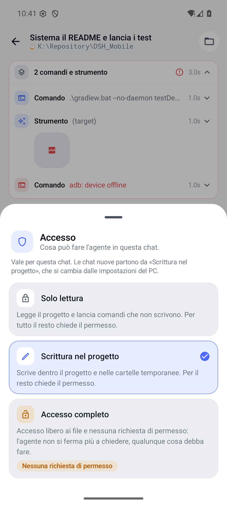 | 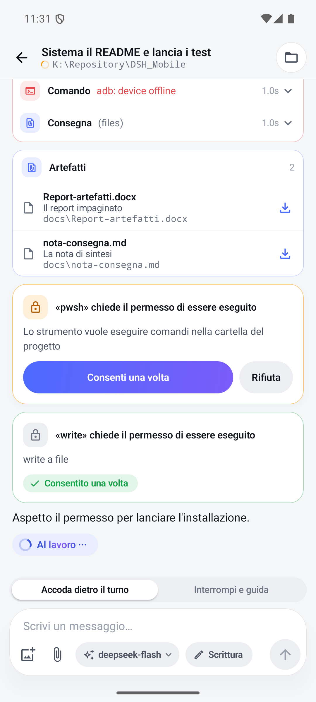 | 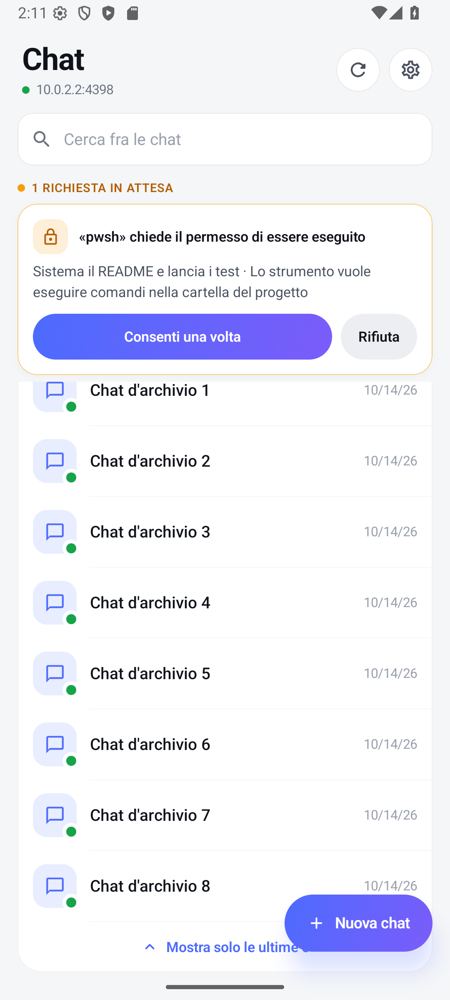 | 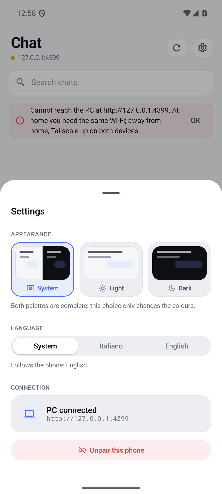 |

| Tool calls, dark | Model picker, dark | Browsing the PC, dark |
|---|---|---|
| 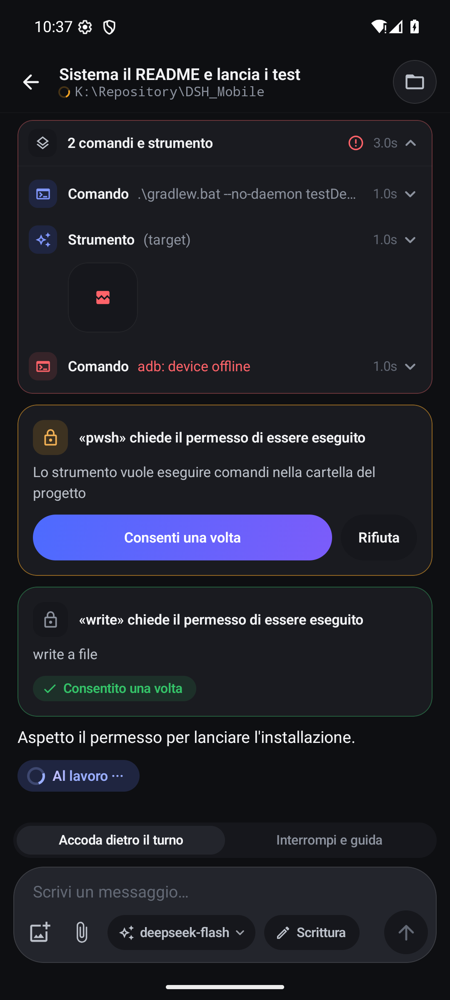 | 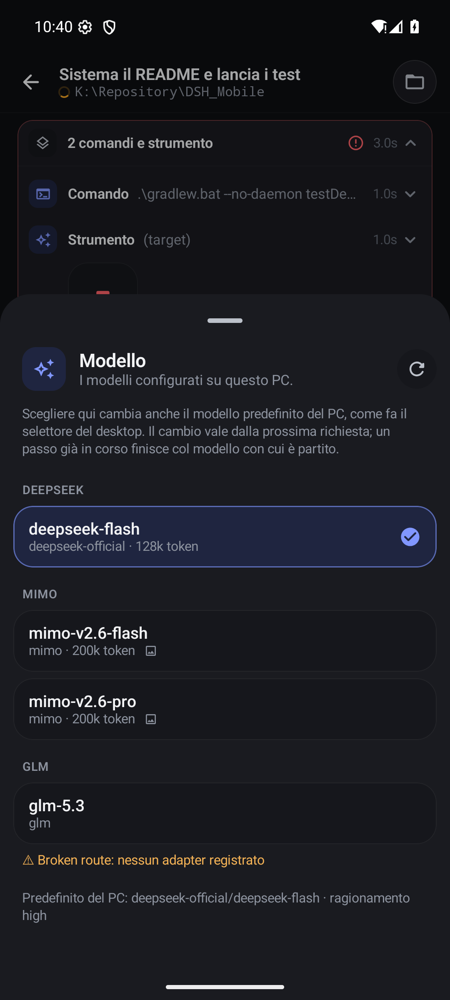 | 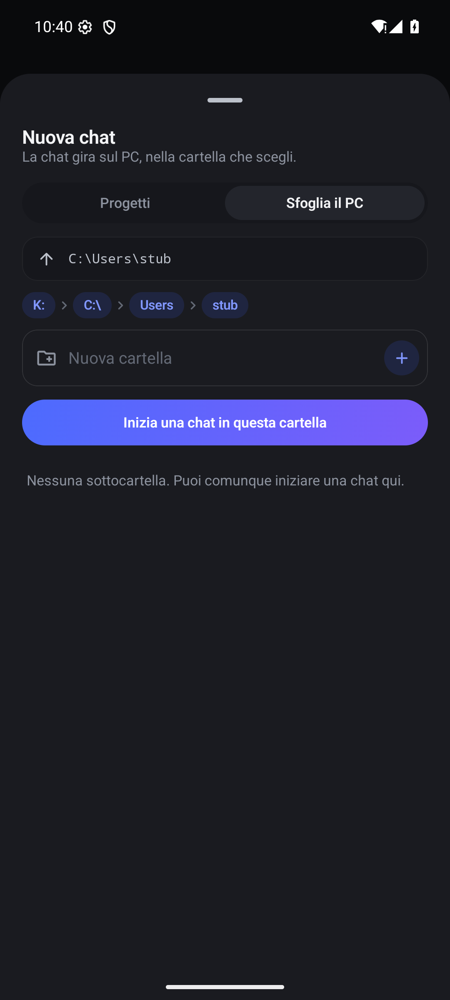 |

A tour of the code — where state lives, how the transcript is folded, why the data layer produces no text — is in **[docs/APP.md](docs/APP.md)**.

---

## Build from source

Everything below runs from `android/`.

**Prerequisites**: JDK 17 (Android Studio's bundled JBR is fine) and the Android SDK with platform 36 and build-tools installed. `android/local.properties` must point at your SDK (it is not in the repository):

```properties
sdk.dir=C\:\\Users\\you\\AppData\\Local\\Android\\Sdk
```

```powershell
# debug build, for a device or an emulator
.\gradlew.bat assembleDebug

# release build
.\gradlew.bat assembleRelease
```

The APKs land in `app/build/outputs/apk/debug/app-debug.apk` and `app/build/outputs/apk/release/app-release.apk`.

### Signing

A release APK that is not signed cannot be installed — `adb install` refuses it, and a phone will not take an update that is not signed by the same key as the version already installed.

Out of the box this project signs the release with the standard debug key (`~/.android/debug.keystore`, generated on first use), which makes `assembleRelease` produce something installable with no secrets to keep. It is also a key anybody has.

To sign with your own key, create `android/keystore.properties` (git-ignored) and the build picks it up automatically:

```properties
storeFile=release.jks
storePassword=…
keyAlias=release
keyPassword=…
```

```powershell
keytool -genkeypair -v -keystore release.jks -keyalg RSA -keysize 4096 `
  -validity 10000 -alias release
```

Keep that file and its passwords somewhere you will still have them in five years: Android decides an update by signature, so losing the key means every installed copy must be uninstalled before a new build can take its place.

---

## Tests

The suites are layered by what they can actually prove. Everything runs on the JVM or in Node; nothing here needs a phone.

**App unit tests** (no device, no emulator):

```powershell
cd android
.\gradlew.bat test
```

The data layer is deliberately plain JVM code — no `Context`, no Compose — so wire decoding, transcript folding, markdown parsing, link classification, folder rules, permission presets, delivery resolution and language parity are all covered by local tests. `TranslationParityTest` reads both `strings.xml` files and fails when a key is missing from one, which is the only thing standing between a half-translated release and a screen that mixes two languages. The suite is the gate a release passes: 300 tests, green, on the commit the APK is built from.

**Plugin suite, offline** (boots the plugin against a stand-in Cordis context and drives the real HTTP routes over loopback):

```powershell
node test/plugin-check.mjs
node test/status-map-check.mjs
```

**Against a real harness** (these boot nothing: they talk to a live instance on which the plugin is mounted, so the services behind the routes are the genuine ones). Run the harness with the plugin on a spare port, then:

```powershell
node test/e2e-real.mjs     http://127.0.0.1:4399 <pairingCode>
node test/workspace-check.mjs http://127.0.0.1:4399 <pairingCode>
node test/file-check.mjs   http://127.0.0.1:4399 <pairingCode>
node test/find-free-session.mjs http://127.0.0.1:4399 <token>
```

**UI without a harness**: `test/ui-stub.mjs` serves the routes the app calls with fixed data chosen so that every interesting case appears on one screen — a diff, a fenced code block, a photo, a tool that produced an image, a failed tool, a waiting approval beside a settled one, two delivered artefacts. It talks to no model and is not a harness: point the app at its address instead of the PC's, and every screen has something to draw.

**Generated strings**: `tools/l10n-build.py` writes `res/values/strings.xml` and `res/values-en/strings.xml` from the tables in `tools/l10n/*.tsv`; `--check` fails if they are out of date. Nobody edits those XML files by hand — see [docs/L10N.md](docs/L10N.md).

---

## Repository layout

```
android/                    Gradle project; the app is the only module
  app/src/main/java/dev/dsh/mobile/
    data/                   wire client, models, transcript folding, markdown, no UI, no text
    ui/                     Compose screens, components, theme, the single AppViewModel
  app/src/test/             JVM unit tests for the data layer
  app/src/main/res/         strings (generated), theme colours, launcher icon
dsh-plugin-mobile-sync/
  lib/index.js              the whole plugin, one file
docs/
  API.md                    route-by-route reference
  APP.md                    how the app is put together
  L10N.md                   the localisation spec (Italian)
  shots/                    the screenshots in this README
test/                       plugin, e2e and UI-stub suites
tools/                      string generator, launcher icon generator
CHANGELOG.md                what each release contains
```

---

## Security

The honest summary: **a paired phone can act on your PC through the harness.** It can approve a tool call, answer a question, and change a session's permission preset to *Full access* — which binds the sandbox to `danger-full-access` and the approval policy to `never`, so the agent stops asking. A lost phone that is still paired is a phone that can do all of that.

What the design does defend:

- **Nothing is unauthenticated but pairing**, and pairing needs a single-use code that exists only in the log and in a `0600` state file. A code can be minted on demand from the PC (`/mobile/pairing-code`, loopback only) and pairing attempts are rate limited per address.
- **A label is not a credential.** The device name is a display string. It cannot recover a token, and two phones may share one.
- **Tokens can be rotated and revoked.** A device that still holds its token can trade it for a new one; `DELETE /mobile/devices/{id}` cuts one off (or the caller itself) without editing a file.
- **The harness's own files are not for the phone.** `/mobile/file` refuses anything inside `$DSH_HOME` — the device table and the provider credentials live there — and any `.credentials*` file, whatever path the client typed.
- **The failure mode is closed.** `allowed-once` is the only outcome that grants anything; anything else, including a malformed answer, denies.
- **No invented promises.** There is no "always allow", because the harness has no persistent permission store to honour it.
- **Nothing survives a restart.** Pending approvals and questions are in-memory, so a card on the phone cannot answer a turn that is already over.
- **Permission changes are logged.** A preset change lands in the session log as a `permission/preset` entry, verifiable on the PC afterwards — that log is the reason it is not a silent in-memory setting.
- **The preview fetcher is the harness's own**, so the phone inherits the host's policy instead of adding a second one to keep in sync.
- **The state file is written atomically and serialised**, so a crash or two simultaneous pairings cannot erase the device table.

If that perimeter is not enough for you, the lever is the network, not the app: keep the default `host: "127.0.0.1"` and reach it over Tailscale, or leave the listener on a network you trust. `DELETE /mobile/devices/{id}` — or emptying `devices` and restarting — cuts every phone off at once.

---

## Troubleshooting

| Symptom | Cause and fix |
|---|---|
| No `mobile-sync: listening` line in the log | The profile was not reloaded, or the `insert:` row is wrong. Close and reopen the harness; check with `dsh --profile <name> --dump-config`. |
| The app cannot reach the PC | Is `host` set? The default is `127.0.0.1`, which admits no phone. Same network? Windows Firewall may be blocking the port on private networks. From the PC, `/mobile/status` answering `401` proves the listener is up. |
| `Pairing code is not valid` | Re-read it from the log, or mint a fresh one on the PC: `http://127.0.0.1:4380/mobile/pairing-code`. |
| `Pairing is closed` | The code was spent. Mint a new one on the PC with `/mobile/pairing-code`, then pair again — a known name no longer recovers a token by itself. |
| `Too many pairing attempts` | Ten a minute per address. Wait a minute; if it was not you, look at the warnings in the harness log. |
| The app says the token is no longer valid | The device was revoked, or `devices` was emptied. Tap **Reconnect** in the banner and pair with a fresh code from the PC. |
| `The PC is writing in this chat` | The harness has one writer per session. Close that chat on the desktop, or write in another session. |
| A permission request never appears on the phone | The listener only registers what the plugin hooks at boot: restart the harness after updating the plugin. |
| `This request is no longer pending` | The turn ended, or the harness restarted. Approvals are in-memory by design. |
| Tapping *Allow* says it was already decided elsewhere | The desktop or another phone answered first. The first answer wins, and that is the intended behaviour. |
| An image says it could not be loaded | Tap to retry. Images of a session whose agent is no longer loaded are still served from the session log, up to the last 400 messages. |
| `This file belongs to the harness itself` | `/mobile/file` refuses `$DSH_HOME` (device table, credentials). Add a `protectedPaths` entry if you want more fences, and open the file on the PC instead. |
| Port 4380 is already in use | Change `port` in the plugin row and restart. A nonsensical `port` is refused at boot, with the value in the message. |
| A link preview says the address is blocked | `preview/blocked` is a non-public destination or a cross-origin redirect, which the harness's fetcher refuses on purpose. |

---

## Contributing

Issues and pull requests are welcome. Two conventions that will save you a round trip:

- **No user-facing sentence in a `.kt` file.** Text lives in the generated `strings.xml`, sourced from `tools/l10n/*.tsv`; the rules are in [docs/L10N.md](docs/L10N.md). Run `python tools/l10n-build.py --check` before pushing.
- **The `data/` layer produces structure, not sentences.** A status is an enum, a problem is a code plus a `TextRef`; that is what keeps the layer testable on the JVM and the wording verifiable against the XML.

---

## License

MIT — see [LICENSE](LICENSE). Copyright (c) 2026 Dotlabs Studios.
